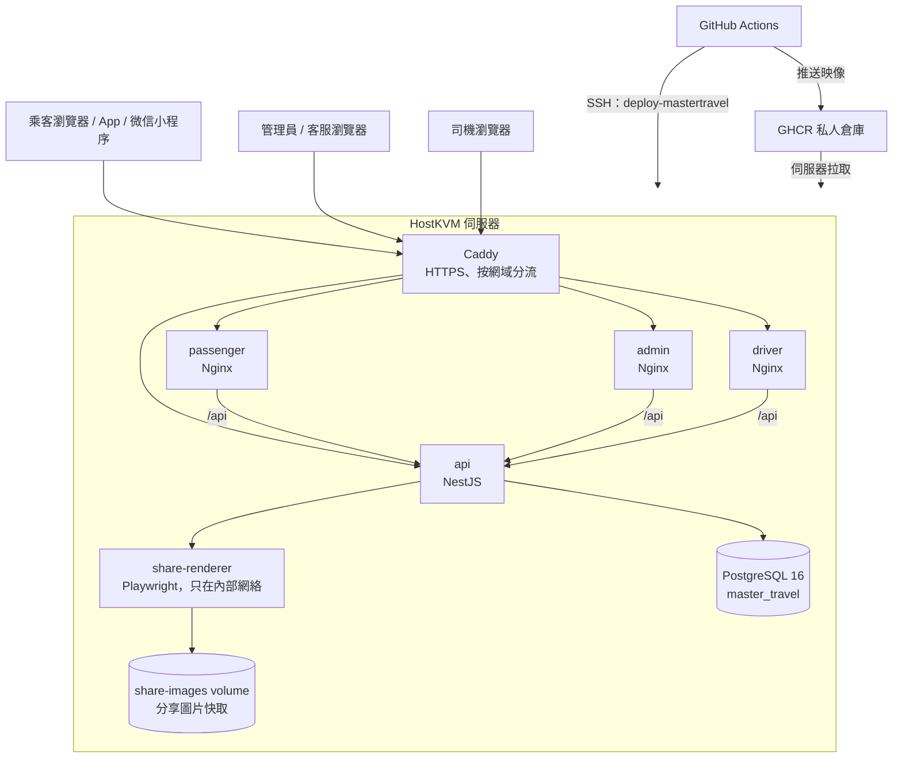

# 正式環境部署架構與操作文件

## 1. 文件目的

本文件說明 Master Travel Project 正式環境的前後端部署架構、服務責任、CI/CD 流程、資料庫 migration、健康檢查、回滾與必要的環境設定。

**2026-10-18（UTC）起，正式環境由 Google Cloud Run 搬到 HostKVM 伺服器**（`45.134.82.239`，與其他 MasterApp 產品共用）：

- 所有服務以 Docker 容器在伺服器上運行，由共用的 Caddy 提供 HTTPS，資料庫是伺服器上共用的 PostgreSQL 16。
- 映像放在 GHCR 私人倉庫（`ghcr.io/masterappit/master-travel-*`），分享圖片快取在伺服器的 Docker volume。Master Travel 的服務已不再使用 GCP；伺服器每日備份仍上傳到共用的 GCS bucket。舊的 run.app 網址已在 2026-10-19 刪除（見第 3 節）。
- 部署由本 repo 的 [`deploy-hostkvm.yml`](../.github/workflows/deploy-hostkvm.yml) 負責。伺服器端的容器設定、部署腳本、專用帳號與 Caddy 網域設定放在本 repo 的 [`deploy/hostkvm/`](../deploy/hostkvm/README.md)（2026-10-19 起，之前在 `masterappIT/MasterApp-infra` 的 `apps/mastertravel/`）。伺服器的共用服務（Caddy、PostgreSQL、每日備份）仍在伺服器的 `/srv/infra/`。搬遷經過與切換記錄見 MasterApp-infra 的 `docs/step-2-master-travel.md`。

舊的 Cloud Run 流程（`deploy-production.yml`、`deploy/cloud-run/`）已停用，只作歷史參考，見 [deploy/cloud-run/README.md](../deploy/cloud-run/README.md)。

> 本文件只記錄架構與操作方式，不記錄任何正式密碼、API 金鑰、Secret value 或個人資料。

## 2. 系統架構



## 3. 服務清單與網域

| 服務 | 技術 | 容器 | 網域 | 主要責任 |
|---|---|---|---|---|
| Passenger H5 | uni-app / Vite | `master-travel-passenger`（Nginx，128MB） | `https://mastertravelapp.masterappinc.com` | 乘客端 Web 介面 |
| Admin Console | Vue 3 / Vite | `master-travel-admin`（Nginx，128MB） | `https://mastertraveladmin.masterappinc.com`（客服工作台：`/support-agent.html`） | 後台管理與獨立客服工作台 |
| Driver Web | Flutter Web | `master-travel-driver`（Nginx，128MB） | `https://mastertraveldriver.masterappinc.com` | 司機接單與訂單操作介面 |
| API | NestJS / TypeScript | `master-travel-api`（1GB） | `https://mastertravelapi.masterappinc.com` | 驗證、權限、商業邏輯、第三方整合；小程序直接連這個網域 |
| Share Renderer | Node.js / Playwright | `master-travel-share-renderer`（1GB） | 不對外，只供 API 經內部網絡呼叫 | 訂單邀請頁與分享圖片產生 |
| Database | PostgreSQL 16 | 伺服器共用的 `postgres` 容器，資料庫 `master_travel` | 不對外 | 正式交易資料與設定資料 |
| Image Cache | Docker volume | `mastertravel_share-images`，掛在 share-renderer 的 `/var/cache/share-images` | — | 分享圖片快取；刪掉會按需要重新產生 |
| Image Registry | GHCR（私人） | `ghcr.io/masterappit/master-travel-{api,share-renderer,passenger,admin,driver}` | — | 保存不可變 container image，每個只留最近 10 版 |

**舊 run.app 網址已刪除**：`master-travel-{api,passenger,admin,driver}-c25rpt3lia-df.a.run.app` 原本由 Cloud Run 轉發到上表的網域，2026-10-19 已刪除這 4 個轉發服務，舊網址回應 404。之前發出的 run.app 派單連結和連舊網址的體驗版小程序不再可用。刪除前的服務設定備份與恢復方法見 MasterApp-infra 的 `docs/step-2-master-travel.md`。

前端產品區域保持獨立：`src/`、`admin/`、`driver/` 不直接引用彼此的實作；跨端資料格式應透過 API 或 `shared/` 契約傳遞。

## 4. 前端部署

### 4.1 Passenger H5

原始碼位於 `src/`，正式建置：

```bash
npm run build:h5
```

產物為 `dist/build/h5`，會被包裝成 `passenger` image，推送至 GHCR，由伺服器拉取後運行。

正式建置時使用（GitHub 變數）：

- `VITE_API_BASE_URL`：`PRODUCTION_API_URL`，即 `https://mastertravelapi.masterappinc.com`
- `VITE_API_URL`：`/api`
- `VITE_PASSENGER_PREVIEW_URL`：`PRODUCTION_PASSENGER_URL`，即 `https://mastertravelapp.masterappinc.com`
- `VITE_DRIVER_PREVIEW_URL`：`PRODUCTION_DRIVER_URL`，即 `https://mastertraveldriver.masterappinc.com`

### 4.2 Admin Console

原始碼位於 `admin/`，正式建置：

```bash
npm --prefix admin run build
```

產物為 `admin/dist`，包含後台首頁與 `/support-agent.html` 獨立客服工作台，會被包裝成 `admin` image。

後台只負責頁面、表單、互動、狀態呈現與 API 呼叫。權限、輸入驗證與商業結果必須由 API 再次驗證；後台不可直接連線資料庫。

### 4.3 Driver Web

原始碼位於 `driver/`，正式建置：

```bash
cd driver
flutter build web \
  --release \
  --dart-define="DRIVER_API_BASE_URL=/api"
```

產物為 `driver/build/web`，會被包裝成 `driver` image。
Driver 瀏覽器請求使用同站 `/api` 反向代理，避免跨站 CORS 預檢；Flutter 依實際頁面來源把 `/api` 解析為絕對 URL，以保留事件串流等 URL 的既有組合方式。前端容器只對 Driver 的 `main.dart.js`、`canvaskit/*.wasm`、Noto Sans TC 字型與 Noto Sans SC 補充字型提供預壓縮 Brotli，保留 gzip 與原檔回退；其他前端沿用既有壓縮方式。nginx 的 ETag／Last-Modified 由檔案修改時間與大小組成，映像建置時會把這些 Driver 字型、`canvaskit/` 檔案及 `main.dart.js`（含 `.gz`／`.br`）的修改時間設為由檔案內容 SHA-256 推導的固定值，內容未變的檔案跨版本保持相同驗證值並回應 304，避免每次發布後重新下載；快取標頭不變。

### 4.4 Nginx 前端容器

三個前端共用 `deploy/frontend/Dockerfile` 與 `deploy/frontend/default.conf`：

- Base image：`nginx:1.27-alpine`
- Container port：`8080`
- 靜態根目錄：`/usr/share/nginx/html`
- 健康檢查：`GET /healthz`
- 支援 SPA fallback 至 `/index.html`
- 啟用 gzip
- 使用 `API_ORIGIN` 反向代理 API；在伺服器上是內部的 `http://master-travel-api:8080`

主要路由：

| 路徑 | 行為 |
|---|---|
| `/api/*` | 轉發至 API 容器，移除 `/api` prefix |
| `/order-invite` | 轉發至 API 分享頁 |
| `/order-invite/share-image` | 轉發至 API 分享圖片 endpoint |
| `/healthz` | 回傳前端容器健康狀態 |
| 其他路徑 | 讀取靜態檔案，找不到時 fallback 至 `index.html` |

## 5. API 部署

API 位於 `backend/`，使用 NestJS + TypeScript。

### 5.1 Container build

`backend/Dockerfile` 使用 multi-stage build：

1. Node.js 20 build stage 安裝 dependencies。
2. 複製 Prisma schema 與 backend source。
3. 執行 `npm --prefix backend run build`。
4. runtime stage 複製建置階段的 `node_modules`、編譯產物、Prisma generated client、schema 與 migrations；目前未執行 production-only 安裝或移除 devDependencies。
5. 以非 root 的 `node` 使用者啟動，工作目錄 `/app/backend`。
6. 監聽 `PORT`（伺服器上設為 `8080`），預設 host 為 `0.0.0.0`。

啟動命令：

```bash
node dist/main.js
```

### 5.2 API runtime 設定

所有設定放在伺服器的 `/srv/apps/mastertravel/app.env`（權限 600，只在伺服器上，不在 GitHub 或映像裏）：

- `NODE_ENV=production`、`PORT=8080`
- `ADMIN_USERNAME`
- `APP_CORS_ORIGINS`：3 個前端網域（乘客、後台、司機）
- `DRIVER_ORDER_URL_BASE`：`https://mastertraveldriver.masterappinc.com/order-invite`
- `SHARE_RENDERER_ORIGIN`：內部的 `http://master-travel-share-renderer:8080`
- `DATABASE_URL`：連伺服器上的 `master_travel` 資料庫（搬遷時建立的新帳號和新密碼）
- `ADMIN_PASSWORD`、`ADMIN_SESSION_SECRET`、`SUPPORT_AGENT_SESSION_SECRET`、`AMAP_WEB_SERVICE_KEY`：搬遷時從 Secret Manager 原樣抄過來

微信小程序的 AppID／AppSecret 由後台設定，加密後存在資料庫 `AppSetting`，不在 `app.env`。

Secret 不可寫入 source code、前端 bundle、Docker image 或 GitHub repository。修改 `app.env` 後要重新建立 API 容器才會生效（見第 12 節）。

### 5.3 CORS 與權限

`APP_CORS_ORIGINS` 使用逗號分隔的 allowlist。API 會依 allowlist 判斷請求來源，不應以任意來源取代正式設定。2026-10-19 刪除 run.app 轉發時已從 allowlist 移除 run.app 網址。

API 負責：

- 管理員登入與 session
- Client / Driver authentication
- CSRF 保護
- Role-based authorization
- Request validation
- 第三方登入與服務憑證驗證
- 付款、退款、審核及其他商業規則

### 5.4 用戶 IP

請求經 Caddy（舊網址還會多經 Cloud Run 轉發）才到 API。API 讀取用戶 IP 時先看 `X-Forwarded-For` 第一個值；Caddy 對 API 和前端都會原樣保留並附加這個標頭。登入限流使用的 `req.ip` 是 Caddy 容器的位址，搬遷前在 Cloud Run 上也是代理位址，行為沒有改變。

## 6. 資料庫與 Prisma migration

正式資料庫是伺服器上共用 PostgreSQL 16 的 `master_travel` 資料庫，只在伺服器內部網絡開放。伺服器每天 03:30（香港時間）把所有資料庫備份到 GCS（由 MasterApp-infra 管理）；每次部署前另有一份本機備份（見第 7 節）。

### 6.1 Migration 原則

API 啟動時不執行 schema migration，但會呼叫 `ensurePricingDefaults()` 與 `ensureMembershipPlanDefaults()` 初始化預設資料。正式 migration 由伺服器的部署腳本執行：用**新版 API 映像**在容器工作目錄 `/app/backend` 執行

```bash
npm run prisma:migrate:deploy
```

若從專案根目錄手動執行相同 migration，命令為 `npm --prefix backend run prisma:migrate:deploy`；須先確認連線環境與發布授權，不可把手動命令當成正式部署流程的替代。

部署腳本的順序：

1. 拉取 5 個新映像。
2. `pg_dump` 備份 `master_travel`。
3. 用新 API 映像執行 migration；**失敗即停止**，容器不會更新，舊版繼續運行。
4. migration 成功後才更新容器。

Migration 必須遵循 expand/contract：先加入向後相容結構，再部署程式與搬移資料，最後於後續版本移除舊結構。正式環境不使用自動 down migration；部署失敗自動退回舊映像時，已套用的 migration **不會**撤銷，所以每個 migration 都必須能與上一版程式共存。

## 7. 提交、推送與正式部署

正式發布只接受同一個已提交 commit SHA 的完整 workflow 結果。單一測試、局部 build、未提交修改、手動 image 或單次 HTTP 200 均不可視為部署候選或部署完成。

發布前必須確認：

- 完整 diff 已檢查，工作目錄乾淨，所有要發布的修改已提交。
- commit SHA、受影響端別及 quality gates 結果可追溯。
- 推送到 `main` 就會自動部署（推送即發布）。

正式 workflow 為 [`.github/workflows/deploy-hostkvm.yml`](../.github/workflows/deploy-hostkvm.yml)。

觸發方式：

- push 至 `main`
- GitHub Actions 手動執行 `workflow_dispatch`
- 每月 2 日 03:00 UTC 排程重建（更新 GeoIP；只部署，不上傳小程序）

API image 建置時下載當月 DB-IP Lite City MMDB，檢查 gzip、MMDB 類型與公開 IP 查詢；下載或驗證失敗會中止建置，不會部署缺少地區資料的 image。資料庫在 image 內由後端本地讀取，不再呼叫 `ipwho.is`；每次 workflow run 的 image tag 包含 commit SHA、run ID 與 attempt，部署一律引用 digest。DB-IP Lite City 資料每月更新，依 [DB-IP 來源及授權](https://db-ip.com) 標示；地區查不到仍回傳「未知地區」。

`deploy` job 的流程：

1. 獨立 quality-gates job 通過後才開始。
2. 確認 workflow commit 仍是目前的 `origin/main`，過時的 run 會停止。
3. 以當次的 `GITHUB_TOKEN` 登入 GHCR（只有 `deploy` job 有 `packages: write`）。
4. 建置 Passenger H5、微信小程序、Admin 與 Driver Web；微信小程序 build 以 `production-mp-weixin-<commit>` artifact 保留 30 天。
5. 建置並推送 `api`、`share-renderer`、`passenger`、`admin`、`driver` 映像（名稱加 `master-travel-` 前綴，帶 `org.opencontainers.image.source` 標籤連到本 repo），解析每個 SHA-256 digest。
6. 以 `deploy-mastertravel` 帳號 SSH 到伺服器，只傳送 commit SHA 和 5 個 digest（次序：api、share-renderer、passenger、admin、driver）。workflow 固定了伺服器的 host key。當次的 `GITHUB_TOKEN` 經 SSH 標準輸入交給伺服器拉映像，不出現在命令列；伺服器不保存，workflow 結束後即失效。
7. 伺服器部署腳本 `/usr/local/sbin/mastertravel-deploy`（來源：[`deploy/hostkvm/deploy.sh`](../deploy/hostkvm/deploy.sh)）：
   1. 驗證參數格式，同一時間只允許一個部署
   2. 用臨時的 Docker 登入目錄從 GHCR 拉取映像，拉完即刪除登入資料
   3. `pg_dump` 備份，保留最近 5 份於 `/srv/apps/mastertravel/predeploy/`
   4. 用新 API 映像執行 migration
   5. 把舊的 `deploy.env` 存為 `deploy.env.prev`，寫入新 digest，重新建立容器
   6. 健康檢查（最多 2 分鐘）：API `/health`、3 個前端 `/healthz`、share-renderer `/health/live`
   7. 健康檢查失敗就換回 `deploy.env.prev` 的映像
8. 經正式網址做 smoke tests：API `/health`、乘客和司機的 `/` 與 `/api/health`。

`wechat-experience` job 見第 10 節。

部署成功後，[`ghcr-retention.yml`](../.github/workflows/ghcr-retention.yml) 把 5 個映像各刪到只剩最近 10 版（也可手動執行）。它和部署用同一個 concurrency group，不會在部署拉映像時刪除。

### 7.1 部署完成的判定

- workflow 的 `deploy` job 成功，代表伺服器已換上本次映像並通過健康檢查。核對方法：伺服器上 `/srv/apps/mastertravel/deploy.env` 第一行寫著部署的 commit，`deploy.log` 有「Deploy <sha> succeeded」。
- 部署會重新建立容器，**網站會中斷幾秒到十幾秒**（Cloud Run 時代是先準備好新版本再切換，沒有中斷）。避免在繁忙時段推送。
- 部署成功不等於業務驗收；登入、下單、司機接單、客服、分享圖要另外實測。
- workflow 執行中只能說「發布中」。

## 8. 健康檢查

| Endpoint | 用途 |
|---|---|
| `/health/live` | process liveness |
| `/health/ready` | 執行 `SELECT 1` 確認資料庫可連線，查詢失敗回傳 503；handler 未設定自身的查詢逾時上限 |
| `/health` | readiness 相容別名；部署腳本與 smoke test 使用 |

資料庫故障不應被 liveness 當成 process failure，避免造成無限重啟。

## 9. Share Renderer

Share Renderer 是伺服器上獨立的容器，負責產生訂單邀請分享圖片與 crawler 需要的分享內容。

- 記憶體上限 1GB，`shm_size` 256MB（Playwright 需要）
- 只在 API 與 renderer 之間的內部網絡，其他產品的容器連不到它，也沒有對外網域
- 使用 `DRIVER_ORDER_URL_BASE`（新司機網域）與 `SHARE_IMAGE_DIR=/var/cache/share-images`
- 分享圖片寫在 Docker volume `mastertravel_share-images`，容器重啟和重新部署後仍可直接使用；這只是快取，刪掉會在下次請求時重新產生。先寫入暫存檔再改名，讀取時不會看到寫了一半的圖片。

API 透過 `SHARE_RENDERER_ORIGIN` 呼叫 Renderer；Renderer 不連資料庫。

## 10. 微信小程序

`deploy-hostkvm.yml` 的 `wechat-experience` job（排程觸發時不執行）：

1. 在 GitHub 的 runner 上 `npm run build:mp-weixin`，`VITE_API_BASE_URL` 是 `https://mastertravelapi.masterappinc.com`。
2. 執行 `scripts/transpile-mp-weixin.mjs`，產物以 `main-mp-weixin-<commit>` artifact 保留 30 天。
3. 把 `dist/build/mp-weixin` 打包，以 `upload-mastertravel-mp` 帳號經 SSH 交給伺服器。
4. 伺服器腳本 `/usr/local/sbin/mastertravel-mp-upload`（來源：[`deploy/hostkvm/mp-upload.sh`](../deploy/hostkvm/mp-upload.sh)）在隔離的容器內用 `miniprogram-ci@1.9.17` 上傳**體驗版**，版本號 `0.2.<run number>`。

- **代碼上傳金鑰只存放在伺服器上**，不在 GitHub。2026-10 GitHub secret 外洩後已重置；舊的 `WECHAT_PRIVATE_KEY` secret 已失效。
- 微信公眾平台的代碼上傳 IP 白名單是伺服器的 IP `45.134.82.239`。
- 微信公眾平台的 request、socket、uploadFile 合法域名：`mastertravelapi.masterappinc.com`。run.app 網域已在 2026-10-19 刪除。
- 上傳只會更新體驗版，不會自動提交審核或發布正式版。截至 2026-10-19 尚未發布正式版。
- 不要再使用 self-hosted runner 上傳小程序。

## 11. 權限與 Secret 分工

| 帳號 | 用途與權限 |
|---|---|
| GitHub `production` environment | `HOSTKVM_DEPLOY_SSH_KEY`、`HOSTKVM_MP_UPLOAD_SSH_KEY` 兩把 SSH 私鑰 |
| `GITHUB_TOKEN`（每次執行自動產生） | 推送映像到 GHCR、交給伺服器拉取、清理舊版本；workflow 結束即失效，GitHub 和伺服器都不保存 GHCR token |
| 伺服器 `deploy-mastertravel` | 只能執行部署腳本，只接受 SHA 和 digest；不能開 shell、不能轉發連線、不在 docker 群組 |
| 伺服器 `upload-mastertravel-mp` | 只能執行小程序上傳腳本 |

即使 GitHub 的部署金鑰外洩，對方也只能部署 GHCR 裏已有的映像，碰不到資料庫和伺服器上的設定。正式密碼只在伺服器的 `app.env`；Secret Manager 裏的舊值在 GCP 清理前仍保留，但已不再被使用。

## 12. 回滾與常用操作

以下命令在伺服器上執行（SSH 帳號由維運人員持有）。

**退回上一版映像**：

```bash
cd /srv/apps/mastertravel
sudo cp deploy.env.prev deploy.env
sudo docker compose --env-file deploy.env up -d
```

**部署某個已存在的版本**：

```bash
sudo mastertravel-deploy <commit-sha> <api> <share-renderer> <passenger> <admin> <driver>
```

5 個參數是映像 digest。手動執行時沒有 GHCR token，腳本不會拉取，只接受伺服器上已有的映像（例如最近部署過的版本）；更舊的版本請重新執行部署 workflow。

**修改 `app.env` 後套用**：

```bash
cd /srv/apps/mastertravel
sudo docker compose --env-file deploy.env up -d api
```

**記錄**：

- 部署：`/srv/apps/mastertravel/deploy.log`
- 小程序上傳：`/srv/apps/mastertravel/mp-upload.log`
- 容器：`sudo docker logs master-travel-api`

Migration 已執行時不可直接假設可以 down migration。若 schema 仍向後相容，優先採用 forward fix；若有資料完整性風險，用 `predeploy/` 的部署前備份或每日 GCS 備份恢復，並先停止寫入、記錄恢復點。

退回 Cloud Run 的整體回退方法見 MasterApp-infra 的 `docs/step-2-master-travel.md`。只限搬遷初期使用，而且切換後新寫入的資料要另外搬回。

## 13. 監控與告警

正式環境至少應監控以下項目。這是維運要求，截至 2026-10-19 **尚未配置**外部監控：

- 4 個網域的 `/health`、`/healthz` 外部檢查
- 伺服器記憶體、磁碟、CPU
- 容器重啟次數
- 每日備份是否成功上傳 GCS
- GitHub Actions deployment failure

Application logs 不得包含密碼、session token、Authorization header 或未核准的個人資料。

## 14. 驗證命令

修改部署、根設定、CI、API、前端或 Prisma 後，應依受影響範圍執行：

```bash
npm run check:dependencies
npm run verify:affected
```

常用單區域驗證：

```bash
npm run verify:api
npm run verify:admin
npm run verify:passenger
npm run verify:driver
```

正式 release 前，GitHub Actions 仍須通過完整 quality gates；本機通過不代表正式部署已完成。

## 15. 相關檔案

本 repo：

- `.github/workflows/deploy-hostkvm.yml`
- `.github/workflows/quality-gates.yml`
- `backend/Dockerfile`
- `deploy/frontend/Dockerfile`
- `deploy/frontend/default.conf`
- `deploy/frontend/build-image.sh`
- `deploy/share-renderer/Dockerfile`
- `deploy/hostkvm/`：伺服器上的 `compose.yaml`、`setup.sh`、`deploy.sh`、`mp-upload.sh`、`accounts.sh`、`forced-command.sh`、`master-travel.caddy`
- `.github/workflows/ghcr-retention.yml`
- `scripts/transpile-mp-weixin.mjs`
- `docker-compose.yml`（僅本機 PostgreSQL）

已停用，只作歷史參考：`.github/workflows/deploy-production.yml`、`.github/workflows/deploy-wechat-experience.yml`、`deploy/frontend/deploy.sh`、`deploy/cloud-run/`、`scripts/upload-mp-weixin.mjs`。

MasterApp-infra（只剩共用服務與歷史記錄）：

- `stack/`：共用的 Caddy、PostgreSQL、Redis
- `backup/`：每日備份
- `docs/step-2-master-travel.md`：搬遷與切換記錄
